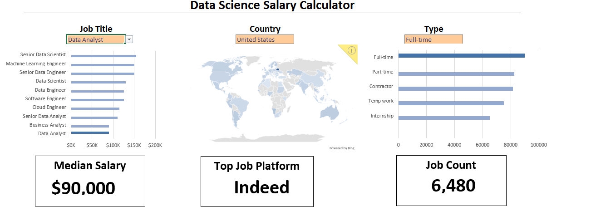
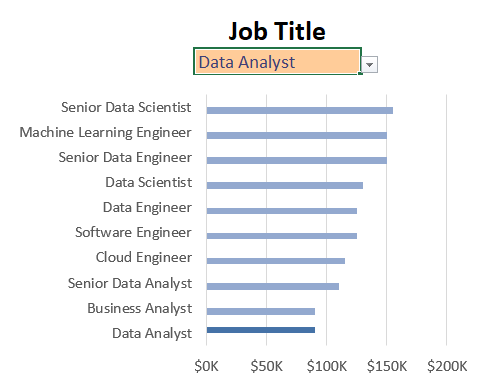
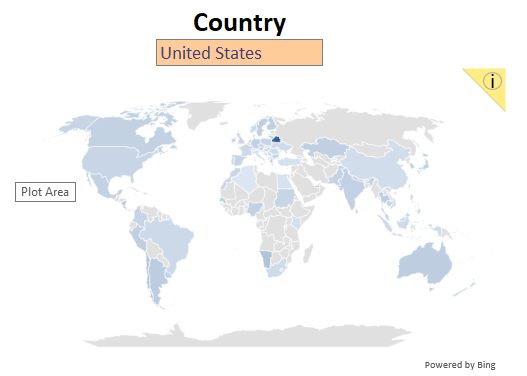
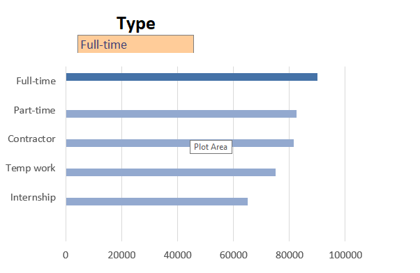
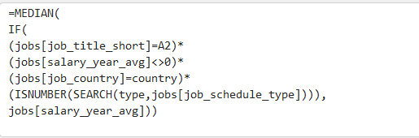

# Excel-Data-Jobs-Salary-Dashboard



## Introduction

This data jobs salary dashboard was created to help job seekers investigate salaries for their desired jobs and ensure they are being adequately compensated. Users select a job title, a country, and a job schedule type from three dropdowns, and the dashboard responds instantly — updating the charts and the summary textboxes in real time.

The data is from Luke Barousse's Excel Data Analytics course and contains real-world data science job postings from 2023. The dashboard uses data validation for its dropdowns and a single `MEDIAN(IF(...))` array formula to drive all of its interactive outputs.

### Dashboard File
My final dashboard is in [Salary Dashboard](workbooks/salary_dashboard.xlsx)

### Excel Skills Used

The following Excel skills were utilized for analysis:

- **📉 Charts**
- **🧮 Formulas and Functions**
- **❎ Data Validation**

### Data Jobs Dataset

The dataset used for this project contains real-world data science job posting information from 2023. It is available via Luke Barousse's Excel Data Analytics course and includes detailed information on:

- **👨‍💼 Job titles**
- **💰 Salaries**
- **📍 Locations**
- **🛠️ Skills**

## Dashboard Build

### 📉 Charts

#### 📊 Median Salary by Job Title - Horizontal Bar Chart



- 🛠️ **Excel Features:** Utilized a horizontal bar chart driven by the `Job Title` dropdown, with the selected title highlighted against all other titles.
- 🎨 **Design Choice:** Horizontal bars for visual comparison of median salaries across job titles.
- 📉 **Data Organization:** Sorted job titles by descending salary for improved readability.
- 💡 **Insights Gained:** Enables quick identification of salary trends, noting that Senior roles and Engineers are higher-paying than Analyst roles.

#### 🗺️ Median Salary by Country - Map Chart



- 🛠️ **Excel Features:** Utilized Excel's map chart to display the country selected in the `Country` dropdown.
- 🎨 **Design Choice:** The map updates to show only the selected country, tying the visual directly to the user's choice.
- 📊 **Data Representation:** Plots the median salary for the country chosen in the dropdown.
- 👁️ **Visual Enhancement:** Improved readability and immediate understanding of the selected market.
- 💡 **Insights Gained:** Gives an instant geographic read on where the selected job title pays well and where it pays less.

#### ⏰ Median Salary by Job Type - Horizontal Bar Chart



- 🛠️ **Excel Features:** Utilized a horizontal bar chart to compare median salaries across job schedule types.
- 🎨 **Design Choice:** Horizontal bars driven by the `Type` dropdown for immediate visual comparison.
- 🎛️ **Interactive:** Updates as the `Type` dropdown changes.
- 💡 **Insights Gained:** Reveals how full-time, part-time, contractor, and other schedule types differ in compensation for the selected job title and country.

### 📊 Dashboard Textboxes

#### 🔢 Median Salary, Top Platform, and Job Count


- 🛠️ **Excel Features:** Three textboxes display the median salary, the platform where the job is most commonly posted, and the job count for the current selection.
- 🧮 **Dynamic Output:** All three recalculate whenever the job title, country, or type dropdown changes.
- 🎯 **Tailored Insights:** Gives a one-glance summary of pay, hiring source, and market size for the selected combination.
- 💡 **Insights Gained:** Helps users see not just what a role pays, but how many openings exist and where those postings tend to come from.

### ❎ Data Validation

#### 🔍 Three Dropdown Selectors

- 🔒 **Enhanced Data Validation:** Implementing filtered lists as data validation rules under the `Job Title`, `Country`, and `Type` options in the Data tab ensures:
    - 🎯 User input is restricted to predefined, validated job titles, countries, and schedule types
    - 🚫 Incorrect or inconsistent entries are prevented
    - 👥 Overall usability of the dashboard is enhanced


### 🧮 Formulas and Functions

#### 💰 Median Salary by Job Title, Country, and Type



- 🔍 **Multi-Criteria Filtering:** Checks job title, country, schedule type, and excludes blank salaries.
- 📊 **Array Formula:** Utilizes `MEDIAN()` function with nested `IF()` statement to analyze an array.
- 🎯 **Tailored Insights:** Returns the median salary for the exact combination of job title, country, and schedule type selected in the dropdowns.
- **🔢 Formula Purpose:** This single formula drives the salary chart and the salary textbox, recalculating whenever any dropdown changes.


#### 🎯 Highlighting the Selected Title on the Chart

```
=IF($D2<>title,$E2,NA())
=IF($D2=title,$E2,NA())
```

- 🔍 **The NA() Trick:** Two helper columns are built with opposing `IF()` logic — one returns the salary only when the row matches the selected title, the other only when it does not.
- 📊 **Chart Layering:** Both columns are plotted on the bar chart; the `#N/A` errors are invisible to the chart, so only the selected bar is displayed in the highlight series while all others remain in the base series.
- 🎯 **Tailored Insights:** The bar for the currently selected job title stands out visually against the rest of the chart.
- **🔢 Formula Purpose:** This makes the chart respond to the dropdown selection without filtering the underlying data.


## Conclusion

I created this dashboard to showcase insights into salary trends across various data-related job titles, countries, and schedule types. Utilizing data from my Excel course, this dashboard allows users to make informed decisions about their career paths. Exploring the three connected dropdowns reveals how location and job type influence salaries — and how a single `MEDIAN(IF(...))` formula plus the `NA()` trick can turn a static dataset into a fully interactive view.
An Excel data analytics project featuring data cleaning, formula-based analysis, and an interactive dashboard.
